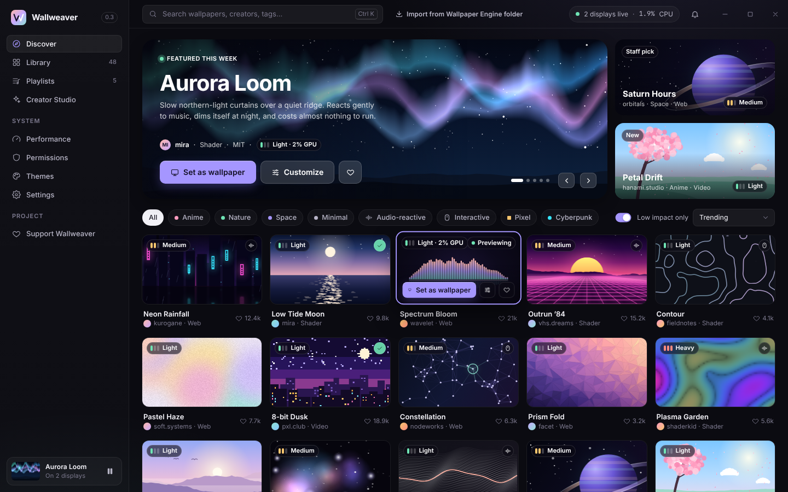
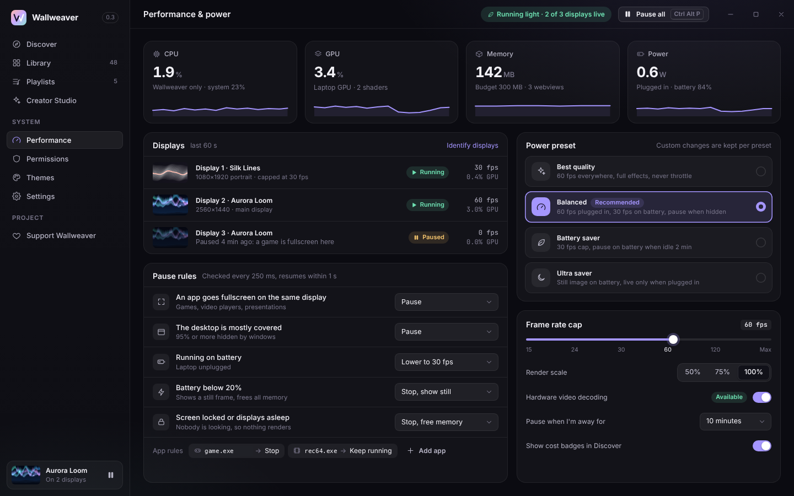
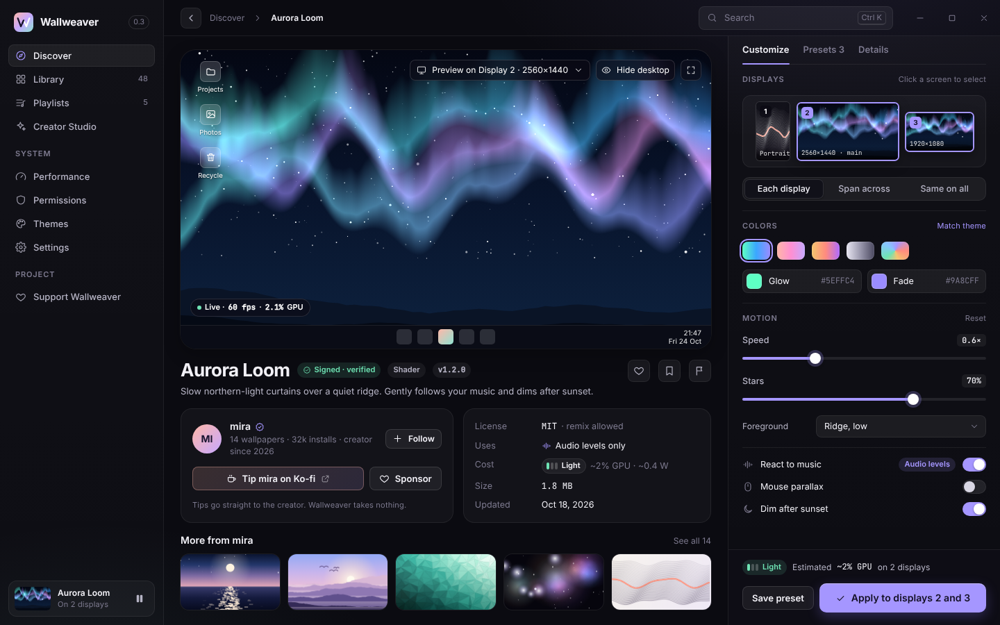
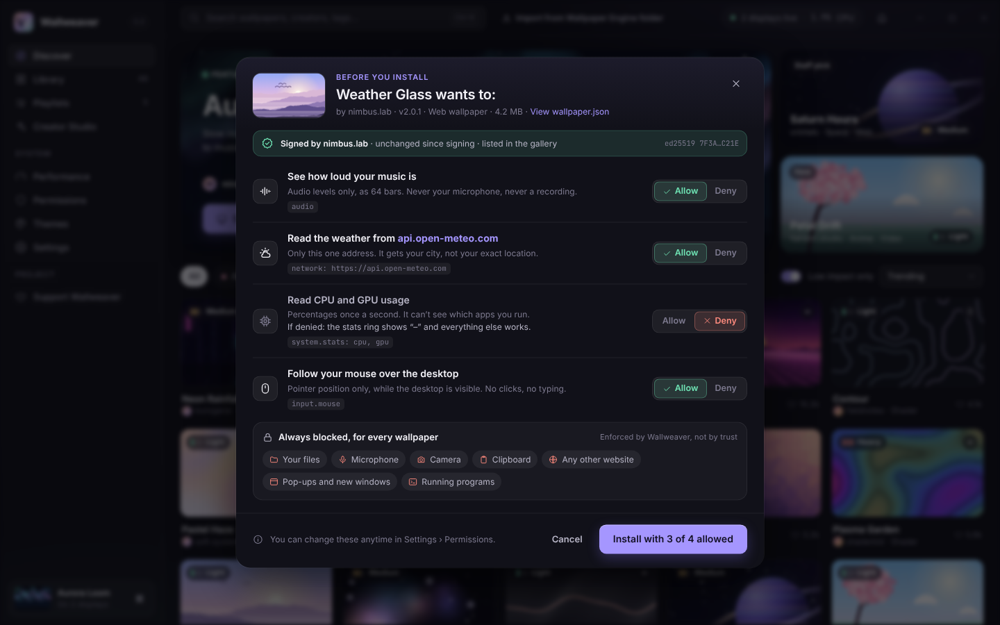

# Wallweaver

**If you can make it, you can wallpaper it.**

Wallweaver is a free, open-source live wallpaper app for Windows, macOS and
Linux. It is built to stay out of your way: small, quiet when you're busy,
and strict about what a wallpaper made by someone else is allowed to do.

> **Status: pre-alpha.** The core (renderer, package format, permissions,
> governor, daemon, CLI) works and is tested. There is no installer yet, and
> the screenshots below are design mockups of the manager window, not a
> shipped product. Don't install this on someone else's computer yet.



## Why it's fast

**No Chromium unless the wallpaper is a web page.** Images, slideshows,
GIF/WebP/APNG animations and shaders are drawn by a small native renderer
written in Rust on top of wgpu (DirectX 12 on Windows, Metal on macOS,
Vulkan or OpenGL on Linux). Only HTML wallpapers get a web view, and that web
view is suspended when paused.

The rest follows from a few rules:

- **Draw only when something changes.** A still image draws one frame and
  then nothing. A slideshow draws when the picture changes. An animated GIF
  draws when its next frame is due. Shaders draw at a frame cap (30 fps by
  default).
- **Paused means zero.** When a game goes fullscreen, the desktop is covered,
  the session is locked or you hit pause, the render thread blocks and does no
  work at all. After five minutes paused, the wallpaper is stopped and its GPU
  memory is released.
- **Shrink once, upload once.** A 4K photo on a 1080p screen is shrunk to
  1080p before it reaches the GPU. Small animations live on the GPU as a
  texture array, so playing them costs no uploads.
- **Two processes, one of them tiny.** `ww-daemon` (tray, governor, desktop
  windows, renderer) runs all the time. The manager window is a separate
  process that only runs while it is open.

Measured on a 4-core cloud VM with a software GPU: the daemon uses **5 MiB of
RAM when idle**, and every wallpaper type uses **0.00% CPU while paused**.
GPU-bound numbers from that machine are not representative of real hardware;
see [docs/BENCHMARKS.md](docs/BENCHMARKS.md) for the full table, the method,
and how to compare against other wallpaper apps fairly.



## Make your own

Drop a file on Wallweaver and it becomes a wallpaper. No account, no upload,
nothing leaves your machine. Package it with a `wallpaper.json` when you want
to share it.

| Source | Status |
|---|---|
| Images (PNG, JPEG, WebP) | works, native |
| Slideshows | works, native |
| Animated GIF, WebP, APNG | works, native |
| GLSL fragment shaders, Shadertoy style (`mainImage`, `iTime`, `iResolution`, `iMouse`) | works, native |
| WGSL fragment shaders | works, native |
| Video (MP4, WebM) | planned: hardware decode straight into GPU textures ([design](docs/VIDEO.md)) |
| HTML, CSS, JavaScript, WebGL, WebGPU | planned: sandboxed web view |
| p5.js, three.js | planned, as web wallpapers |
| Godot web exports | planned, as web wallpapers |
| Lottie, Rive | planned |
| Live2D, Spine | planned |
| Any website | planned, with explicit network permission |

Things we won't do: run `.exe` files or native plugins from the gallery.
That is the single biggest way wallpaper apps get abused.



The [examples](examples/) folder has a GLSL plasma, a WGSL aurora, a
slideshow and a GIF, each with a valid manifest. The manifest format is
documented in [docs/MANIFEST.md](docs/MANIFEST.md) and has a
[JSON Schema](schema/wallpaper.schema.json) for editor completion.

```sh
wallweaver validate examples/plasma-shader
wallweaver keygen -o me                      # me.wwkey (secret), me.wwpub
wallweaver pack examples/plasma-shader -o plasma.wwp
wallweaver sign plasma.wwp --key me.wwkey -o plasma.signed.wwp
wallweaver verify plasma.signed.wwp --trust me.wwpub
```

## Security model, in plain words



A wallpaper from someone else is untrusted code that runs all day on your
desktop. Wallweaver treats it that way:

- **Nothing is allowed unless it is declared and you approve it.** A
  wallpaper lists what it wants in `wallpaper.json` (audio levels, CPU usage,
  one named website, your mouse position). You see each item in plain language
  and can say no to any of them. Undeclared means denied, and the app enforces
  that, not the wallpaper.
- **Gallery wallpapers can only get what they declared.** Your own
  wallpapers can be given anything you choose, including local-network access
  that a downloaded wallpaper can never have.
- **Packages are signed.** A `.wwp` file carries an ed25519 signature over
  the hash of every file. A changed byte breaks it. Unsigned packages only
  load in developer mode.
- **Unpacking is defensive.** Paths that try to escape the folder, symlinks,
  duplicate or case-colliding names, zip bombs and oversized packages are
  refused before anything is written. The package reader is fuzzed.
- **Web wallpapers (when they land) are locked down.** A strict Content
  Security Policy built from the approved permissions, a second network check
  in the app, no navigation, no pop-ups, no shared cookies.

What this doesn't promise: it isn't magic. A sandbox reduces what a hostile
wallpaper can do; it can't make a bug in a graphics driver or an operating
system disappear. If you find a way around any of this, please report it
privately (see [SECURITY.md](SECURITY.md)).

## Platforms

| | Windows 10/11 | Linux (X11) | Linux (Wayland) | macOS |
|---|---|---|---|---|
| Renderer (images, slideshows, animations, shaders) | builds; not yet run on real hardware | works (tested on a software Vulkan GPU) | builds; needs the host below | builds |
| Desktop host (window behind the icons) | written, including the Windows 11 24H2 layout; untested | works (tested under Xvfb + openbox) | not yet (layer-shell planned) | not yet |
| Fullscreen / covered / battery detection | written; untested | works | not yet | not yet |
| Tray icon | written; untested | not yet (manager window has the same controls) | not yet | not yet |
| Manager window (Tauri) | in progress | in progress | in progress | in progress |
| Installer | not yet | not yet | not yet | not yet |

Windows, macOS and Linux reach v1.0 together. An Android live wallpaper is
planned for v1.x. iOS has no API for third-party live wallpapers, so iOS will
only get a companion app. See [docs/ROADMAP.md](docs/ROADMAP.md).

## Repository layout

| Path | What |
|---|---|
| `crates/ww-manifest` | `wallpaper.json` types and validation |
| `crates/ww-package` | `.wwp` packing, signing, verification, safe unpacking, fuzz targets |
| `crates/ww-permissions` | default-deny permission model, consent text, CSP, network filter |
| `crates/ww-governor` | run / throttle / pause / stop decisions (pure logic) |
| `crates/ww-render` | native wgpu renderer |
| `crates/ww-desktop` | `DesktopHost` trait and the Windows and X11 hosts |
| `crates/ww-ipc` | versioned messages between the manager window and the daemon |
| `crates/ww-daemon` | the always-running process |
| `crates/ww-bench` | benchmark harness behind `wallweaver bench` |
| `crates/wallweaver` | the `wallweaver` command-line tool |
| `app/`, `ui/` | the manager window (Tauri + Svelte) |
| `examples/` | sample wallpapers |
| `docs/` | architecture, manifest, roadmap, content policy, benchmarks |

Building needs a recent stable Rust. `cargo test --workspace` runs
everything; the renderer tests draw headlessly and use a software GPU when
there is no real one (on Linux, install `mesa-vulkan-drivers`). The manager
app embeds `ui/dist`, so run `pnpm -C ui install && pnpm -C ui build` before
building the whole workspace.

## Fan art and content

Fan art is welcome and is tagged as fan art. It is never sold through premium
packs and never used in official promotion. Rights holders have a public
takedown process. Details: [docs/CONTENT-POLICY.md](docs/CONTENT-POLICY.md).

## Prior art

Wallweaver learned from these projects. No code was copied from them; both
are GPL-licensed and Wallweaver is MIT/Apache-2.0.

- [Lively Wallpaper](https://github.com/rocksdanister/lively): the open-source
  Windows wallpaper app that showed what's possible with video and web
  wallpapers.
- [linux-wallpaperengine](https://github.com/Almamu/linux-wallpaperengine): a
  Linux player for existing wallpaper content.

## Support the project

Wallweaver is free and will stay free. Security and performance features are
never paywalled.

- Ko-fi: https://ko-fi.com/wallweaver (placeholder)
- GitHub Sponsors: https://github.com/sponsors/cig13zs (placeholder)

## License

Licensed under either of [Apache License, Version 2.0](LICENSE-APACHE) or
[MIT license](LICENSE-MIT) at your option. Unless you explicitly state
otherwise, any contribution you submit for inclusion is dual licensed as
above, without any additional terms or conditions.
